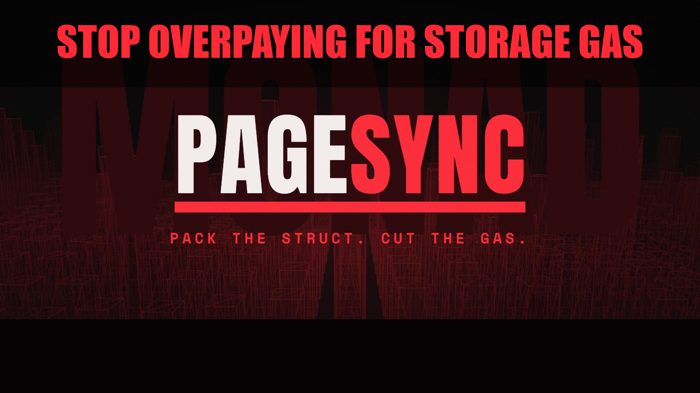
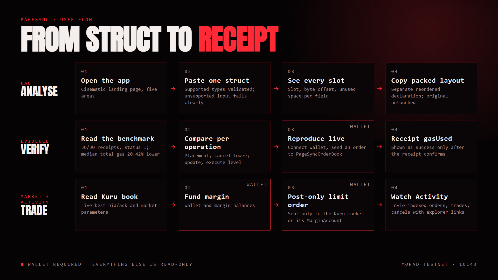
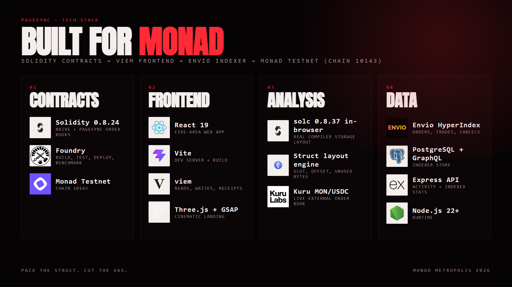

<div align="center">



# PageSync

**Pack the struct. Cut the gas.**

See the storage slot before you ship it. A Solidity storage-optimisation tool and research case study on **Monad Testnet** (chain ID `10143`), built for the Monad Metropolis hackathon.

[Live demo](https://monad-page-sync.vercel.app) &nbsp;·&nbsp; [In-app docs](https://monad-page-sync.vercel.app/#/docs) &nbsp;·&nbsp; [Benchmark results](benchmark/results/monad-receipt-benchmark-repeated.md)

<!-- Trailer video: add `[Trailer video](URL)` to the line above once the link exists. -->

</div>

> PageSync is a developer and research tool. It is testnet-only, does not handle real value, does not guarantee savings, and does not modify deployed contracts.

## Contents

- [The problem](#the-problem)
- [What PageSync does](#what-pagesync-does)
- [Try it in 60 seconds](#try-it-in-60-seconds)
- [Research result](#research-result)
- [User flow](#user-flow)
- [Tech stack](#tech-stack)
- [Architecture](#architecture)
- [Deployment](#deployment)
- [Repository layout](#repository-layout)
- [Getting started](#getting-started)
- [Configuration](#configuration)
- [Deployed contracts](#deployed-contracts)
- [Testing](#testing)
- [Safety](#safety)
- [Limitations and roadmap](#limitations-and-roadmap)
- [Team](#team)

## The problem

Every byte you waste in contract storage is gas you pay for. Solidity gives each struct field its own 32-byte slot unless the fields are packed, and storage layout is invisible until you pay for it. A normal order, with a trader, price, quantity, side and status, can take four storage slots when two would hold the same data.

Monad is fast, but speed does not make wasted storage free. PageSync lets developers see the slot before they ship it.

<div align="center">

</div>

*Poster bars are illustrative of the idea. Measured values are in [Research result](#research-result).*

## What PageSync does

PageSync reads a Solidity struct, shows every slot, byte offset and wasted byte, then suggests a safe packed layout. The web app has five areas. A cinematic landing page introduces them; the in-app **Docs** page explains each in detail.

| Area | Purpose |
|---|---|
| **Lab** | Paste one Solidity struct and see each field's slot, byte offset and unused space. Get a separate, copyable reordered declaration (the original is never changed silently). A second tab inspects the known `NaiveOrderBook` and `PageSyncOrderBook` layouts. Analysis is cross-checked against the real Solidity compiler (solc, in the browser). |
| **Evidence** | The saved receipt benchmark, a byte-accurate layout comparison with measured gas per operation, and a live reproduction that sends an order to the PageSync contract. |
| **Market** | The Kuru MON/USDC order book on Monad Testnet: live best bid/ask and market parameters, wallet and margin balances, funding and post-only limit orders. |
| **Activity** | Orders, trades and cancellations indexed by Envio, with filters, auto-refresh and explorer links. |
| **Docs** | How to use each tool, wallet and network setup, method and limits, troubleshooting, glossary. |

A wallet is only needed for the live reproduction and for placing Market orders. Everything else is read-only.

## Try it in 60 seconds

1. Open the [live demo](https://monad-page-sync.vercel.app) and scroll the landing page to the **-20.42%** result.
2. Go to **Lab**, pick the **Order** preset and press **Optimize & Verify**. Read the slot map, then copy the packed declaration.
3. Go to **Evidence → Receipts** for the measured gas per operation, then **Simulation** and press **Replay**.
4. Open **Activity** to see indexed orders, each linked to its transaction on the explorer.

No wallet is needed for any of these steps. (The free-tier backend can take up to a minute to wake on first load.)

## Research result

The experiment compares `NaiveOrderBook` and `PageSyncOrderBook` on Monad Testnet using separate transactions and the **receipt `gasUsed`**, not `gasleft()`, estimates or gas limits.

- `NaiveOrderBook`: an `Order` struct occupying four storage slots.
- `PageSyncOrderBook`: a packed representation in two storage words (`data1` trader/price, `data2` quantity/flags).

Three repeated workloads completed, and **30 of 30** receipt statuses were `1`.

> PageSyncOrderBook showed approximately **20.42% lower median total receipt gas** than NaiveOrderBook.

| Operation | Naive median | PageSync median | Difference |
|---|---:|---:|---:|
| Placement | 99,870 | 81,986 | 17.91% lower |
| Second placement | 116,950 | 81,998 | 29.89% lower |
| Update | 36,030 | 36,394 | 1.01% higher |
| Cancel | 51,769 | 34,806 | 32.77% lower |
| Execute | 35,273 | 35,294 | 0.06% higher |

Per-run totals were 20.42%, 19.35% and 20.42% lower; across all runs the aggregate was 20.05% lower. Update and execute stay level, and PageSync shows that too.

**Limits.** Both contracts remain mapping-based and PageSync has no explicit page allocator, so the result is workload-specific evidence. It does not prove a Monad storage-page locality or warming mechanism, and it is not a universal gas guarantee. Envio is an indexer, not a gas profiler.

## User flow



A wallet is required only for the live reproduction and for funding and placing Market orders. A transaction is shown as successful only after its receipt confirms it.

## Tech stack



| Layer | Technology |
|---|---|
| Contracts | Solidity 0.8.24, Foundry |
| Frontend | React 19, Vite, viem, Three.js |
| Analysis | solc 0.8.37 (in-browser), client-side struct layout engine |
| Backend | Node.js 22+, Express |
| Indexer | Envio HyperIndex, PostgreSQL, Hasura GraphQL |
| Chain and venue | Monad Testnet (`10143`), Kuru MON/USDC market |

## Architecture

```text
React + Vite frontend
  ├─ client-side struct analysis and layout inspection
  ├─ saved receipt benchmark + byte-level layout view
  ├─ live reads/writes through viem (Monad Testnet RPC)
  └─ Kuru market workspace
          │
          ├─ Solidity contracts + Foundry scripts and tests
          └─ Express API ──► Hasura GraphQL ──► PostgreSQL ◄── Envio indexer
                  (optional: only the Activity page and indexed stats need it)
```

Event IDs are `<transactionHash>-<logIndex>` and every indexed row stores the real transaction hash; the handlers fail loudly rather than write a row without one. Details are in [`envio/README.md`](envio/README.md).

## Deployment

| Piece | Where | Notes |
|---|---|---|
| Frontend | Vercel | Static build of `frontend/` |
| API | Render web service | Docker, `backend/` |
| GraphQL | Render web service | Hasura over the Render PostgreSQL database |
| Database | Render PostgreSQL | Shared by Hasura and the indexer |
| Indexer | Render web service | Docker, `envio/`; needs `ENVIO_API_TOKEN` and the Hasura admin secret |

Free-tier services sleep when idle, so the first request after a pause can be slow. The Envio deployment steps, environment variables and free-plan caveats are in [`envio/README.md`](envio/README.md#deploy-to-render).

## Repository layout

| Path | Contents |
|---|---|
| `contracts/` | `NaiveOrderBook.sol`, `PageSyncOrderBook.sol`, interfaces |
| `script/` | Foundry deploy/benchmark scripts and PowerShell receipt-benchmark runners |
| `test/` | Foundry tests (order book, storage experiment, benchmark) |
| `benchmark/results/` | Saved receipt benchmark artifacts (JSON and Markdown) |
| `deployments/` | `addresses.json` for the deployed contracts |
| `frontend/` | React + Vite web app, see [`frontend/README.md`](frontend/README.md) |
| `backend/` | Express API, see [`backend/README.md`](backend/README.md) |
| `envio/` | Envio HyperIndex indexer, see [`envio/README.md`](envio/README.md) |
| `assets/` | README images: thumbnail, poster, user flow, tech stack |

## Getting started

Requirements: Node.js 22+, [Foundry](https://book.getfoundry.sh/) for the contracts, and WSL 2 on Windows for the Envio indexer.

### 1. Frontend

```bash
cd frontend
npm install
npm run dev
```

The Lab, Evidence and Docs pages work with the frontend alone.

### 2. Backend (optional)

```bash
cd backend
npm install
npm start
```

Serves on `http://localhost:3001`. The frontend calls it for Activity and indexed stats.

### 3. Envio indexer (optional)

Envio does not run natively on Windows; use WSL 2. See [`envio/README.md`](envio/README.md) for the exact commands, including how to resume safely without losing indexed data.

### 4. Contracts

```bash
forge build
forge test
```

## Configuration

Create a local, git-ignored `.env` at the repository root (see `.env.example`):

| Variable | Used by | Purpose |
|---|---|---|
| `MONAD_RPC_URL` | Foundry | Monad Testnet RPC endpoint |
| `PRIVATE_KEY` | Foundry scripts | Deployer/benchmark key, testnet wallet only |
| `ENVIO_GRAPHQL_URL` | Backend | GraphQL endpoint (default `http://localhost:8080/v1/graphql`) |
| `PORT` | Backend | API port (default `3001`) |
| `ENVIO_API_TOKEN` | Envio | HyperSync access token; lives in `envio/.env` |

The frontend reads `VITE_API_URL` if you need to point it at a backend other than `http://localhost:3001`.

## Deployed contracts

Monad Testnet, chain ID `10143`, explorer `https://testnet.monadexplorer.com`.

| Contract | Address |
|---|---|
| NaiveOrderBook | [`0x9eDDb8B7612954014Af0fFA58dc9d93dB2C75d68`](https://testnet.monadexplorer.com/address/0x9eDDb8B7612954014Af0fFA58dc9d93dB2C75d68) |
| PageSyncOrderBook | [`0x5De52bC09A2A688f6c4615099465e9049CC83bC1`](https://testnet.monadexplorer.com/address/0x5De52bC09A2A688f6c4615099465e9049CC83bC1) |
| Kuru MON/USDC market | [`0xa241896A7Dbe8a550D2E5fF7A914bB1989ceD2D9`](https://testnet.monadexplorer.com/address/0xa241896A7Dbe8a550D2E5fF7A914bB1989ceD2D9) |

The Kuru market is an external venue. PageSync reads it and sends transactions only to the Kuru market or its MarginAccount, and shows a transaction as successful only after a receipt confirms it. The PageSync reference market is used only for storage experiments.

## Testing

```bash
forge test                      # contracts
cd frontend && npm test         # struct-layout engine tests
cd frontend && npm run lint     # oxlint
cd frontend && npm run build    # production build
cd envio && node --test test/eventMeta.test.js   # event id / transaction-hash checks
```

## Safety

- Keep `MONAD_RPC_URL`, `PRIVATE_KEY` and any API tokens in the ignored `.env` only. Never put credentials in source, README files, benchmark artifacts or commits.
- Use a testnet wallet and review every wallet prompt.
- Reordering struct fields changes storage layout. Do not apply a reordered struct to an existing deployment, persisted data or an upgradeable proxy.

## Limitations and roadmap

Not goals: a production exchange, real-value trading, universal Solidity compilation, automatic modification of deployed storage, treating Envio as a gas profiler.

Generic storage inspection needs an ABI and compiler storage layout; an address alone is not enough.

Future work: broader Solidity type support, more networks, generic ABI/layout inspection, saved analyses, deeper Kuru book data, and richer Envio fill/cancellation analytics.

## Team

| | Role |
|---|---|
| [Nerain Prakash I J](https://github.com/nerain-prakas) | Contracts, benchmark and app |
| [sharnika-06](https://github.com/sharnika-06) | Brand kit and documentation |

Built for the Monad Metropolis hackathon. Gas is a design decision.
